<!--
Copyright (c) 2026 Brian Kircher

Open Source Software: you can modify and/or share it under the terms of the BSD
license file in the root directory of this project.
-->

This project is a small (75.2 mm by 44.7 mm) circuit board in the shape of the
FIRST&reg; logo.  Each symbol in the logo is painted the appropriate color, and
has a sequence of 11 LEDs (of matching color) along the symbol.  Normally, the
badge appears to be just a FIRST logo, however once a minute the LEDs are lit
up in a variety of animations to give it an extra bit of pizzazz.  Running on
an [ATtiny1616](https://www.microchip.com/en-us/product/attiny1616), the
firmware is designed to run for several days on a single CR2032 battery (so the
badge can easily last for an entire international competition on a single
battery).

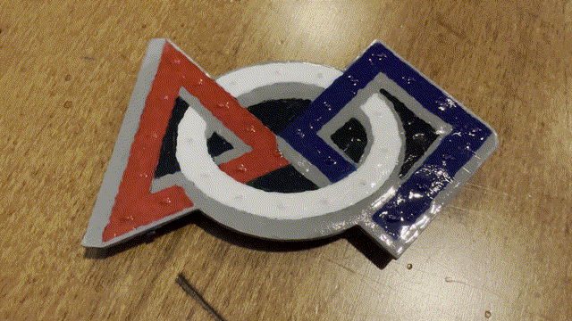


# Prototyping

To develop the firmware, an
[ATtiny1616 Breakout with seesaw](https://www.adafruit.com/product/5690) from
Adafruit, with a [UPDI Friend](https://www.adafruit.com/product/5879), also
from Adafruit, was used to develop the firmware (and prove it out prior to
designing and purchasing a custom board!).  They were plugged into a small
[breadboard](https://www.adafruit.com/product/65), along with a couple of
jumper wires to connect the UPDI Friend to the ATtiny1616 Breakout (note that
the jumper wires are hidden by the left LED board).

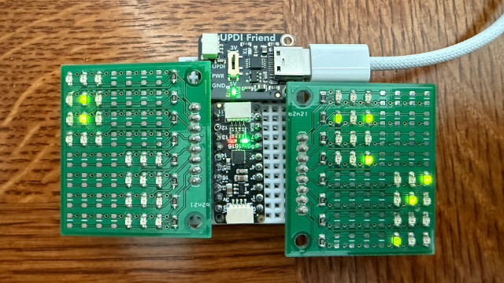

From a previous project, I had a set of 7x8 Charlieplexed LED boards, most of
which had only 24 LEDs populated (in independent 3x4 grids).  Which worked
perfect here, since each symbol in the logo has 11 LEDs on it!

While the blue array could only drive 6 of the 12 LEDs (due to the pinout of
the ATtiny1616 Breakout), the setup had an added benefit of an on-board LED
that was used to show the time the processor was in run mode versus sleep mode.
This helped to direct optimizations in the firmware (by highlighting areas and
animations that were inefficient).  Viewing this signal with an oscilloscope
was also helpful in this regard.


# Firmware

The firmware is written using [TinyGo](https://tinygo.org), which provides a
quick and simply means of getting low level code up and running on an
ATtiny1616.  It generates code that is close to or as efficient as C, while
also being safer than C (no arbitratry pointers that can lead to weird and
wonderful crashes).  Using Go also makes it easy to use the native Go compiler
to build the code to run on the host computer (see [Simulating](#simulating)
below).

Because the LEDs are driven using
[Charlieplexing](https://en.wikipedia.org/wiki/Charlieplexing), a bit more is
required of the firmware to drive them.  A timer generates an interrupt every
millisecond, and the interrupt handler manages switching the state of the three
Charlieplexed LED arrays to light up the LEDs as needed for the currently
running animation.

This timer is also used to sample the push button on the badge, providing
software debouncing and press versus hold detection.

By using the disassembler in [binutils](https://sourceware.org/binutils)
(`objdump -d`), the machine code that is generated by the TinyGo compiler can
be examined to help determine where there are inefficiencies in the code.
Since animations run for a few seconds every minute, in a way the efficiency of
the animation code "doesn't matter much" (though saving current wherever
possible helps battery life).  However, if the animation code is too
inefficient, it can't complete in time (the animation function is called every
16 ms, so should complete within 16 ms minus the time taken by the 1 ms
interrupt handler) and the speed of the animation is affected.  For some tips
about things that can lead to inefficient code, see
[Things to Avoid in the Firmware](#things-to-avoid-in-the-firmware).


# Simulating

While the prototype setup allowed the LEDs to be driven by the firmware, they
were not arranged in the same places and colors as on the actual badge.  To
solve this problem, a "simulation" is used to run the actual animation code
on a computer, using ANSI control sequences to provide a rough approximation
of the layout of the LEDs on the badge.  Even with a physical badge in hand, it
is faster to use the simulator to develop and test patterns by avoiding the
slow build/flash/run cycle.

The other nice thing in the simulator is a simple way to slow down the
animation, so that it is much easier to see what is happening as the LEDs are
being turned on and off.  As an example, this helped tremendously in finding
state errors in the two sweep animations.

To run a simulation:

```
go run .
```

This runs the simulation of the `sparkle` animation:

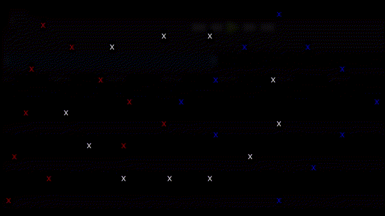

Command line arguments adjust how the simulation runs:

`-anim <string>` - Selects the animation to run.  For example, `-anim logo`.

`-rate <uint>` - Selects the animation speed, which is specified as a divisor.
                 For example, `-rate 2` runs the animation at half speed,
                 `-rate 4` runs the animation at quarter speed, and so on.  The
                 default is `-rate 1`, running the animation at normal speed.

`-time` - Gather and print out timing statistics of running the animation
          function.  The minimum, average, and maximum run time, in
          nanoseconds, is displayed when the simulator exits.

So, for example, to run the `logo` animation at 1/4 speed:

```
go run . -anim logo -rate 4
```

Note that using `-time` is not indicative of the run time on the actual badge;
it is the time used by the animation when compiled to run on your computer.  It
is useful only as a relative measure; if a new animation takes 10 times longer
to run than an existing animation in the simulator, it will likely be 10 times
slower on the badge as well (which could be problematic).


# Things to Avoid in the Firmware

There are some things that the AVR processor in the ATtiny1616 doesn't do well
at all (or possibly the TinyGo compiler doesn't do them well):

* The modulo operator (`%`).  This operation is performed with a library
  function since the AVR processor does not have a division or modulo
  instruction.  There is plenty of processing power to use this operation, but
  the processor is run really slowly (sub-MHz) in order to save battery power.
  A couple of modulo operations in an animation quickly consumes all of the
  available clock cycles in the animation loop.

* The division operator (`/`).  Same story as the modulo operator; they are in
  many ways paired.

* The multiplication operator (`*`) on 16- or 32-bit values.  Since AVR is an
  8-bit processor, 16- and 32-bit multiplication requires a multi-step library
  function to perform.  Multiplication is definitely faster than division, but
  it still requires a library function and therefore numerous clock cycles.  Of
  note, multiplying two 8-bit values into a 16-bit value is an instruction that
  takes 2 clock cycles, which is quite reasonable.

Note that saying these should be avoided doesn't mean they should never be
used.  The thing that runs repeatedly and most often is the animations; using
these in the main code is less impactful as using them in an animation.


# Adding a New Animation

There are three steps to adding a new animation:

1. Create the animation function in a new file.  It is easiest to take an
   existing animation (such as `sparkle.go`), copying it to a new file,
   renaming the animation function in the new file to match the file name (for
   example, `sparkle.go` has a function called `sparkle` to perform the
   animation), and replacing the contents of the function with new code to
   perform the new animation.

2. Insert the new function into `animations` array in `main.go`, making it
   available for random selection to run.  Commenting out all the other
   animations can be helpful as a development step to guarantee that the new
   animation always runs, making it easier to see it "in real life"!

3. Insert the new function into the `-anim` parsing code in `simulation.go`.
   This makes it available for running inside the simulator, which is really
   helpful while developing the animation (it is a much quicker development
   cycle, and the ability to easily slow down the animation helps as well).

Copmaring the run time (with the `-time` parameter) in the simulator to
existing animations can help to gauge the efficiency of the animation code.
The true test is to look at the output generated by the ATtiny1616 code (using
`showActive`) with an oscilloscope or logic analyzer, though this is not a
capability that is exposed on the badge itself (and requires the prototyping
setup shown above).


# Designing the Badge

The first step in designing any circuit board is to create a schematic for the
board.  For the badge, it is rather simple; a CR2032 powering the ATtiny1616,
driving three independent 3x4 Charlieplexed LED arrays (with each array only
containing 11 of the 12 possible LEDs).  The LED count decision was a bit of a
co-design with the board layout, since the geometry of the logo helped drive
the number of LEDs that made sense.

Since the idea was to have a badge/board shaped like the FIRST&reg; logo, the
first step of the board layout was to determine the desired size of the badge
and generate the appropriate board outline.  An image of the FIRST&reg; logo
was taken from a Google search and imported into [KiCad](https://kicad.org) (in
the `User.Comments` layer):

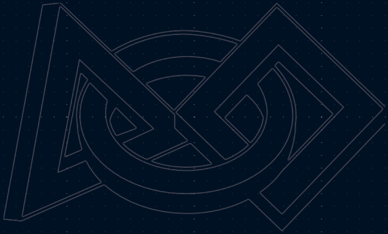

After sizing this to produce a board of the appropriate size (in this case,
75.2 mm wide, or approximately 3 inches), the outline of the logo was traced
onto the `Edge.Cuts` layer, defining the outline of the board.  The inner lines
of the logo were also traced into the `F.Silkscreen` layer, providing a
reference for later painting the badge:


This step was rather tedious since all the arcs in the logo appear to be a
circle that was tilted in three-dimensional space and projected down to a
two-dimensional surface, meaning that they are not a simple, regular ellipse.
Therefore, each of the longer arcs are made of up several smaller arcs to
approximate the shape.

The next step was the place the LEDs along the three elements of the logo.
Being a bit persnickety, I used a lot of math to precisely determine the
locations for each LED (so that they are evenly spaced and sit along the
middle of the symbol), and manually entered the resulting locations for each
LED.

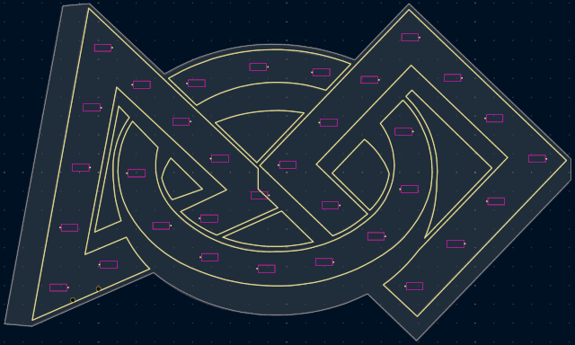

For the sake of cleanliness, all of the remaining components were placed on the
back side of the board.  The first thing to position was the exposed copper for
soldering on the safety pin to allow the badge to be worn (note that this image
and the next is how the board appears from the back, which is flipped from how
it appears in KiCad):

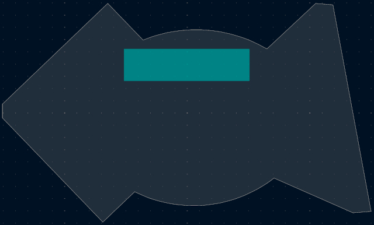

Then, the remainder of the components were placed:

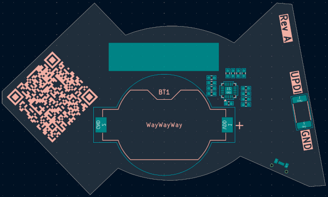

Two special things of note:

* The "WayWayWay" text behind the battery is an indicator to
  [PCBWay](https://pcbway.com) of where they can place their board number when
  they fabricate the board (so it doesn't appear on the front side for
  example!).

* The QR code that points to the page for this project; a nice touch for those
  who see the badge in person and want to know more!

Then came the "simple" matter of placing all the traces to make the required
electrical connections.  Given that all the signals are very low speed and low
current, the routing on the badge is rather sloppy, and could probably be done
in a much cleaner manner.

Routing Charlieplexed LED arrays is definitely cleaner when they are in a grid.
However, these LEDs are not in a grid, and that is guaranteed to make the
routing a bit messier.

Given that the routing on the front side of the board is covered by paint, and
the back side of the board isn't seen when the badge is being worn, messy
routing isn't an aesthetic problem.

In order to make it easy to fabricate, the board is designed with 6/6 design
rules (meaning 6 mil traces and 6 mil gaps), and a minimum drill size of
0.3 mm (12 mil).  It is rather odd that many board houses use imperial (mils)
for trace/space and metric for drills...  Anyway, 6/6 with 0.3 mm minimum
drills is a very low-tech, common board these days, and basically any board
house can produce them very inexpensively.


# Ordering the Badge

The files needed to order boards depends on the board house.  Some can take
native KiCad files (which is amazing!), some can take Gerber X2 file (which can
be generated by KiCad), while some can still only take the original Gerber
format (as is the case with PCBWay).  Which files you generate are based on the
requirements/capabilities of the board house you chose.

Since I use PCBWay, the KiCad board file is setup to generate the original
Gerber format.  My experience with two-layer boards from PCBWay is about five
days from ordering to them being delivered, and the quality is really good.
YMMV of course, and I'm sure that any other board house would also do a good
job with this design.

This is the easiest step in the entire project!


# Populating the Badge

Because of the big, bulky things on the back of the badge (notably the CR2032
battery holder!), it is easiest to populate the front of the badge first.  This
involves carefully placing the 33 LEDs in the correct places and orientations.
Since there are three colors, the correct color must be placed at each
position.  Because the LEDs arrays are Charlieplexed, the orientation is just
as important as if they were driven normally.  Reversing just one LED results
in an LED that doesn't turn on when requested, and two LEDs that turn on
together when just the other one is requested!

The simpliest way to populate the LEDs is to use a small dab of solder paste on
each pad, place the LEDs, then reflow the LEDs.  Either a professional reflow
plate can be used, a hobbiest hot plate setup, a hobbiest toaster oven reflow
setup, or just a soldering iron!

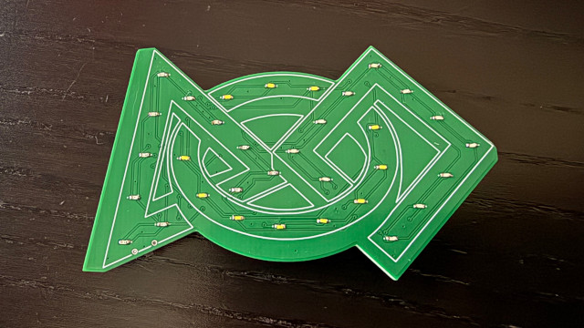

After the LEDs are installed, the remainder of the componeonts can be installed
on the back side of the board.  It is probably best to install the battery
holder last, since it's height (along with the copious amount of plastic in its
construction) make it challenging to work around once installed.  The
ATtiny1616 is the only tricky component to install, mainly because of its
exposed ground pad in the middle.  A thin coat of solder on all 21 pads (the
pads for the 20 pins plus the exposed ground pad), a bit of flux, and some hot
air (from a hot air rework station) gets this part down fairly easily (given
the appropriate skill and experience).

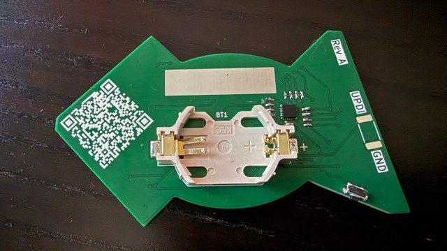

The blue LED array uses zero Ohm current "limiting" resistors (since their high
forward voltage and the internal resistance of the CR2032 battery handle it
"for free"), which can be populated with actual 0 Ohm resistors (they are
~$0.01 in bulk), or a blob of solder can be placed between the pads instead (as
a super inexpensive "0 Ohm resistor"!).


# Painting the Badge

The following paints are used to paint the front of the circuit board after the
LEDs are installed:

* [Liquitex Basics - Primary Red (#415)](https://www.amazon.com/Liquitex-BASICS-Acrylic-Paint-Titanium/dp/B0012F3B4Y)
* [Liquitex Basics - Titanium White (#432)](https://www.amazon.com/Liquitex-BASICS-Acrylic-Paint-Titanium/dp/B004M56VU2)
* [Liquitex Basics - Primary Blue (#420)](https://www.amazon.com/Liquitex-BASICS-Acrylic-Paint-Primary/dp/B004IXDBZG)
* [Liquitex Basics - Neutral Gray Value 5 (#599)](https://www.amazon.com/Liquitex-BASICS-Acrylic-Paint-Neutral/dp/B0060KTFUK)
* [Liquitex Basics - Ivory Black (#244)](https://www.amazon.com/Liquitex-BASICS-Acrylic-Paint-Ivory/dp/B0014ZQQBW)

Where there would normally be a hole in the logo (where it is transparent on a
computer screen), the board is painted black.  The silkscreen on the front of
the board provides the guide for where to paint each color; grab a paint brush,
some paint, and your kindergarten skills to color inside the lines!

The edges of the PCB are also painted gray for a cleaner overall appearance.

Note that the manufacturer confirmed that this line of acrylic paints is
non-conductive; which was confirmed via testing.  If a different paint is used,
make sure that it is non-conductive so it does not interfere with the
electronics!

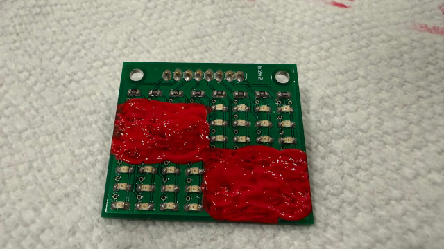

Yes, this paint job is terrible; this was about confirming the paint is
non-conductive, not about being pretty!

After painting the badge, it looks like this:

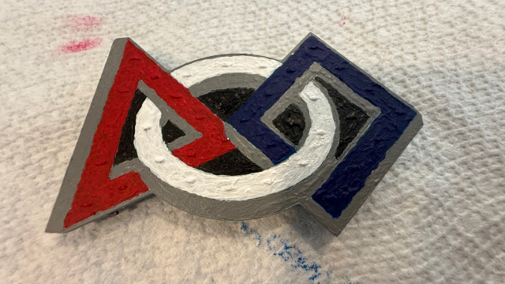

Note that I painted on top of all the LEDs; they are bright enough to show
through the thin layer of paint.  This also provides a cleaner appearance to
the paint job (of course, this is a matter of opinion!).

In order to protect the paint job, five coats of clear sealer is applied:
[Mod Podge Acrylic Sealer - Gloss](https://www.amazon.com/Mod-Podge-1470-Acrylic-Sealer/dp/B003VYD9DM).
Like the paint, the manufacturer was contacted to try to confirm the
non-conductivity of the sealer; they did not have data to confirm this fact,
but felt based on the formulation that it is likely non-conductive.  So, a test
was performed (as would have happened anyway if the manufacturer was able to
confirm it is non-conductive):

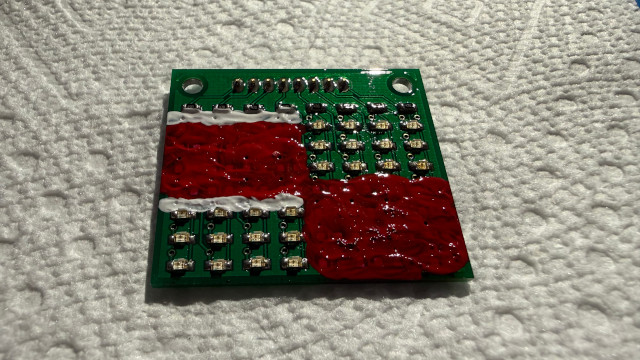

Not only did this sealer not impact the performance of the LED array, a
voltmeter did not detect any conductance when the probes were placed a couple
of millimeters apart on the cured sealer surface.

When applying the sealer to the badge, great care must be taken to avoid
getting any of the sealer into the battery holder (where it could block the
electrical connection of the battery) or the push button (which could keep it
from operating).  In general, the sealer should be kept from the back side of
the board; I used masking tape to block off the back side of the board:

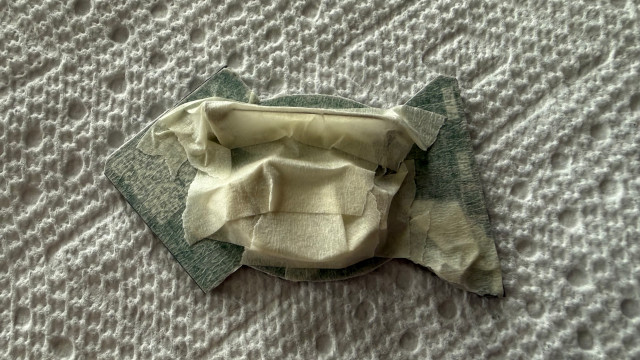

After sealing the badge, it looks like this:

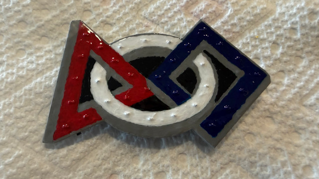


# Powering the Badge

The badge is designed to be powered by a CR2032 coin cell battery.  Given the
relatively high internal resistance of these batteries, no current limiting
resistors are needed for driving the LEDs (the battery's internal resistance
is effectly the current limiting resitor).

When bench testing, it is often useful to power the badge with a bench supply.
However, this could be really "dangerous" given the lack of current-limiting
resistors on the LEDs!  Too much current through the LEDs and they will release
their magic smoke; then all that is left is a charred LED that does not emit
any light!

This can be solved by setting a low current limit on the bench supply (around
10 mA).


# Programming the Badge

The ATtiny1616 utilizes the UPDI programming interface, which requires only a
single data line (plus a ground reference).  There are two pads on the bottom
of the board near the left edge, under the red triangle.  To attach to those
pads to program the ATtiny1616, a homemade clothespin debug interface is
utilized to attach a UPDI Friend from Adafruit.  One side of the clothes pin
has two copper pads that connect to the pads on the circuit board, and the
other side has some padding to protect the front of the board.

The clothes pin debug interface, top view:

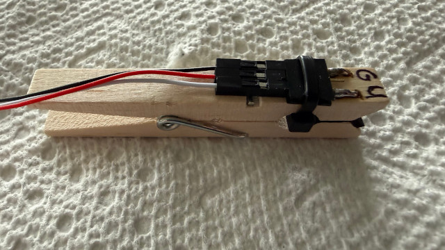

The clothes pin debug interface, side view:

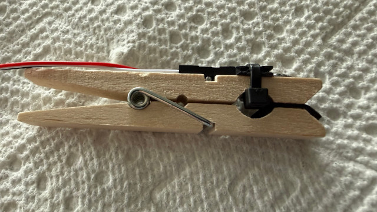

The clothes pin debug interface, with the "jaws" open:

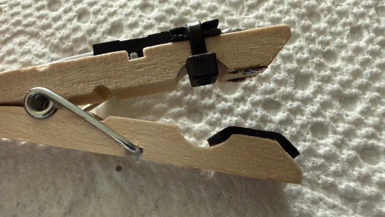

The initial programming should be done prior to painting the board; if the
firmware never needs to be updated, there is no chance of messing up the paint
job!  Additionally, it is wise to ensure that everything works on the board
prior to covering it with paint (which blocks components on the front side of
the board, and makes it more challenging to apply heat to the back side of the
board without messing up the paint job!).


# Wearing the Badge

There is a spot on the back of the badge for soldering a safety pin (such as
[this one](https://www.amazon.com/Locking-Safety-Brooch-Silver-Jewelry/dp/B0DNQFC7CN)
on Amazon) for easy attachment to a garment.  Note that the exposed area is
part of the large ground plane, and therefore it takes a decent amount of heat
to get the safety pin soldered!  Flux and patience are your friend here.

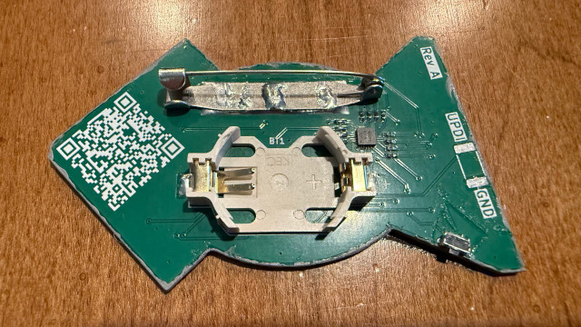

Note that since the safety pin is connected to the ground plane, and the
portion of the CR2032 battery that is exposed is the positive terminal, care
must be taken to not short the battery to the safety pin using an external
metal object.  Placing some tape over the battery after it is installed can
alleviate this concern.


# Purchasing Supplies

Though the links above are for Amazon (in some cases, for convenience alone),
it does not hurt to shop around (Michael's, Hobby Lobby, and so on) as the
supplies may be available for much less from other retailers.  Though sometimes
the convenience of a single order is affordable in its own way!
